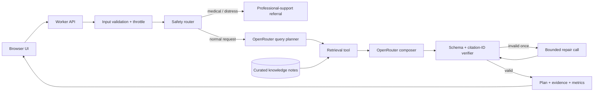

# Away Companion — Architecture

## Product goal

Away Companion helps a pet parent create a cautious, evidence-grounded enrichment plan for a dog while the owner is away. It is an independent Happy While Away hackathon prototype, not an official company product.

## Runtime flow



## Components

| Component | Responsibility |
| --- | --- |
| `ui/index.html` | Responsive single-page experience, profile form, plan timeline, source library, activity trace and export. |
| `worker/index.js` | Cloudflare Worker routes, SSE streaming, request-size checks, origin checks and best-effort rate limiting. |
| `lib/core.mjs` | Safety routing, hashed lexical vectors, retrieval, OpenRouter calls, response validation and sample plans. |
| `data/knowledge.json` | Eight stable-ID evidence notes with publisher, URL, and paraphrased guidance. |
| `faiss_service/app.py` | Optional Python/FastAPI retrieval service using FAISS `IndexFlatIP(256)`. |
| `scripts/build.mjs` | Bundles the UI, core logic and corpus into a self-contained Worker ESM artifact. |
| `tests/` | Unit, orchestration, HTTP, safety and citation checks. |

## Agent workflow

1. Validate the dog profile and question.
2. Route medical or distress signals deterministically; bypass generation and return a referral plan.
3. In live mode, ask OpenRouter's configured model for a short retrieval query.
4. Retrieve the top four notes, then merge mandatory safety and boundary notes.
5. Ask OpenRouter for a JSON plan grounded only in those notes.
6. Validate required fields, length limits and every citation ID.
7. If validation fails, allow exactly one repair call. If it fails again, show an error and no unverified plan.
8. Stream stage summaries to the browser. Never expose private model reasoning.

## Retrieval design

The hosted Worker uses normalized 256-dimensional feature-hashed lexical vectors and exact cosine similarity. This is intentionally small and dependency-free for eight short notes. It is transparent and deterministic, but sensitive to wording and not a substitute for semantic embeddings at scale.

The optional Python service uses the same vectors in FAISS `IndexFlatIP(256)`. Because vectors are normalized, inner product equals cosine similarity. It is authenticated with `RETRIEVER_TOKEN`, returns source IDs and scores, and never accepts arbitrary source text from callers.

The public deployment uses the Worker retriever. It does not claim to run native FAISS inside the Worker runtime.

## Security and safety boundaries

- `OPENROUTER_API_KEY` is server-side only and configured as a Site secret.
- The browser never receives environment variables or the API key.
- Live requests are size-limited and rate-limited on a best-effort per-isolate identity basis.
- No arbitrary URL fetching, shell execution, file upload, order action, notification, purchase, or pet monitoring exists.
- The app does not diagnose or prescribe. Distress and medical keywords route to professional support.
- Plans do not invent Happy While Away inventory, prices, delivery status, or policies.
- Citation validation proves IDs resolve, not that generated claims are fully entailed. Human review is still required.

## Scaling path

For a production version: replace lexical features with a versioned embedding model; add chunking, metadata filters and retrieval evaluation; add durable user quotas and spend controls; store source snapshots and provenance; add expert-reviewed safety policies; and measure unsupported-claim rate, citation precision and referral recall.

## Local commands

```sh
node scripts/dev.mjs
node --test tests/core.test.mjs tests/http.test.mjs
node scripts/build.mjs
node scripts/validate-artifact.mjs
```

Optional FAISS service:

```sh
pip install -r faiss_service/requirements.txt
uvicorn faiss_service.app:app --host 127.0.0.1 --port 8000
```
