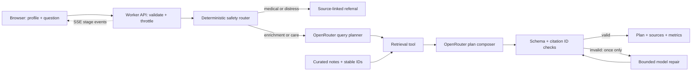

# Away Companion

A small, source-grounded enrichment planning app built as an independent **Happy While Away** hackathon submission. MIT-licensed application code; built on open-source Node.js, FastAPI and FAISS.

## Problem statement

Pet parents need a practical starting point for enrichment when leaving home. Generic chatbots can invent product claims, omit supervision constraints, and mistake boredom for separation-related distress. Build a compact assistant that uses a dog profile and curated evidence to create an inspectable plan, answer questions, and escalate concerns outside its scope.

## Why this company

Happy While Away describes itself as a Bengaluru pet brand working to reduce boredom and anxiety in dogs. Its hiring post also describes contributing 10% of profit on each kept order toward street-dog care. These are company statements, not independently audited claims. The storefront could not be inspected during research, so this prototype deliberately contains no invented inventory, pricing, stock, delivery promises or return policy.

Source: [Happy While Away's hiring post](https://in.linkedin.com/jobs/view/marketing-and-content-creator-at-happy-while-away-4491814353). Public guidance is linked individually in `data/knowledge.json` and the app's knowledge library. Notes were curated on 22 November 2026; they are paraphrases, not full source documents or veterinary-approved app content.

## What works

- Responsive profile and personalized enrichment timeline.
- Explicit sample mode that works without model calls.
- Live OpenRouter query planner and evidence-grounded composer.
- Streaming workflow events, source inspection, token/call/latency metrics.
- Deterministic safety routing, schema and citation-ID validation, one repair attempt.
- Follow-up questions using the current profile; each is a fresh request, not a persistent chat history.
- Brief export and last-run persistence in browser localStorage. Clear local data in the About dialog.
- Optional authenticated Python FAISS retrieval service, with Docker packaging.

## Architecture



This is a constrained agent workflow: model-based query planning, a retrieval tool, a model composer, and deterministic checks. It is not an open-ended autonomous swarm, and the activity view shows stage summaries rather than chain-of-thought.

### Retrieval: hosted vs FAISS

The deployed Cloudflare Worker uses **exact cosine similarity over normalized 256-dimensional feature-hashed lexical vectors**. This requires no paid embedding endpoint and is appropriate for eight short notes. These vectors capture token overlap, not semantic meaning; hash collisions and phrasing sensitivity are known limitations. The top four ranked notes are merged with mandatory safety context. Consequently a small corpus often sends most of its notes to the composer; that is intentional, and not evidence of sophisticated large-corpus retrieval.

The included Python service uses **FAISS `IndexFlatIP(256)`** on the same normalized vectors. Inner product equals cosine similarity after normalization. Configure `RETRIEVER_URL` and `RETRIEVER_TOKEN` to make the Worker call it instead of its built-in retriever. The live submission does not claim to run native FAISS inside a Worker. For scale, replace the lexical encoder with a versioned sentence embedding model, introduce chunking and metadata filters, and benchmark retrieval before adding an approximate index.

### Engineering boundaries

- API keys exist only in server runtime secrets, never client code or source files.
- Normal live runs make two LLM calls; a malformed plan allows one more call. Each call has a 60-second timeout. The planner allows 4,096 total output tokens and the composer 8,192, including the configured model's mandatory reasoning budget. JSON response mode is requested; reasoning content is excluded from the response.
- Citation checks prove that referenced IDs exist, **not** that the model's assertions are entailed. Human review remains necessary.
- Safety routing is a conservative English keyword/profile heuristic, not a clinical classifier. It cannot reliably detect every concern or language.
- Sample mode is deterministic and labeled; live failures remain errors rather than silently presenting sample content as AI output.
- The per-isolate/IP throttle (four live starts per minute) is best effort, not a durable global quota. For a larger public launch add platform rate limits, a durable daily budget, and authenticated user quotas.
- Profile and question are sent to OpenRouter in live mode. Browser-local saving is not encrypted and is device-specific. No application database, order integration, purchases, notifications or live pet monitoring is included.
- No arbitrary URL fetching, file ingestion, shell tools, or model-initiated external actions.

## Run locally

Requires Node.js 20 or later. The hosted app has no npm runtime dependencies.

```sh
node scripts/dev.mjs
# Open http://127.0.0.1:4173
```

Set `OPENROUTER_API_KEY` in your shell environment to test live mode locally. The dev script intentionally does not auto-load `.env` files. Use `OPENROUTER_MODEL` to override `baidu/ernie-5.5-flash-preview:free`. Free-model availability, capacity and limits are controlled by OpenRouter. Model errors are shown in the app.

```sh
node --test tests/core.test.mjs
node scripts/build.mjs
node scripts/validate-artifact.mjs
```

The generated `dist/server/index.js` is a self-contained Worker ESM module. Sites deployment uses `.openai/hosting.json`; source and archive must match the same pushed commit. Secrets are configured through the hosting provider and excluded from the package.

## Run FAISS locally or in a container

```sh
python -m venv .venv
# Activate the virtual environment for your shell, then:
pip install -r faiss_service/requirements.txt
# Set RETRIEVER_TOKEN to a fresh secret in your shell environment.
uvicorn faiss_service.app:app --host 127.0.0.1 --port 8000
```

Set `RETRIEVER_URL=http://127.0.0.1:8000` and the same `RETRIEVER_TOKEN` in the Node dev server environment. A deployed Worker needs an HTTPS-reachable service, not your loopback address.

```sh
docker build -t away-companion-faiss .
docker run --env RETRIEVER_TOKEN -p 8000:8000 away-companion-faiss
```

`GET /health` reports index information. `POST /retrieve` accepts `{"query":"safe enrichment toy","k":4}` with `Authorization: Bearer <RETRIEVER_TOKEN>`. It returns source IDs and scores, never arbitrary source text supplied by a caller. Missing credentials fail closed. Do not publish the retrieval token in the browser.

## API

| Route | Purpose |
| --- | --- |
| `GET /api/health` | Runtime model/configuration summary; no secret values |
| `GET /api/knowledge` | Curated public evidence notes |
| `POST /api/plan` | SSE `stage`, `result` and `error` events |

Request shape:

```json
{"profile":{"name":"Milo","age":"adult","hours":3,"chew":"moderate","mood":"bored"},"question":"How do I introduce a new toy?","mode":"demo"}
```

## Reviewer walkthrough (3 minutes)

1. Open the app: the initial plan is clearly marked as a sample.
2. Change the name, chewing style and absence duration; create another plan.
3. Click a source chip and inspect the original guidance.
4. Turn on Live AI; create a plan and inspect Agent activity for actual stage events and API usage.
5. Ask a question about safe enrichment. Then select Distressed and run again: generation is bypassed for a source-linked referral.
6. Save the brief. Open How it works to inspect the architecture and limitations.

Suggested pitch: “I built an evidence-grounded enrichment assistant for the brand's mission. The interesting part is not the chat box: it is the bounded workflow, inspectable retrieval, explicit failure handling, and honest separation between sample output, live model output and safety referrals.”

## Evaluation and next steps

Automated checks cover retrieval relevance on a known query, vector normalization, malformed input, valid sample citations across 27 profile combinations, safety bypass, mock live orchestration, exhausted repair, and provider failure. These are software checks, not evidence of clinical efficacy or comprehensive retrieval quality.

The optional Python FAISS tests are included, but the local Windows host blocked loading the native FAISS DLL under Application Control. This is an environment restriction, not a passing runtime test. Validate the optional service in an allowed environment before connecting it to the public app.

Next work: expert review of the knowledge base; a labeled evaluation set for retrieval and answer support; semantic embeddings; verified company catalogue and policy ingestion; durable budgets; multilingual escalation evaluation; and user feedback. Measure unsupported claim rate and referral recall before asserting accuracy improvements.
